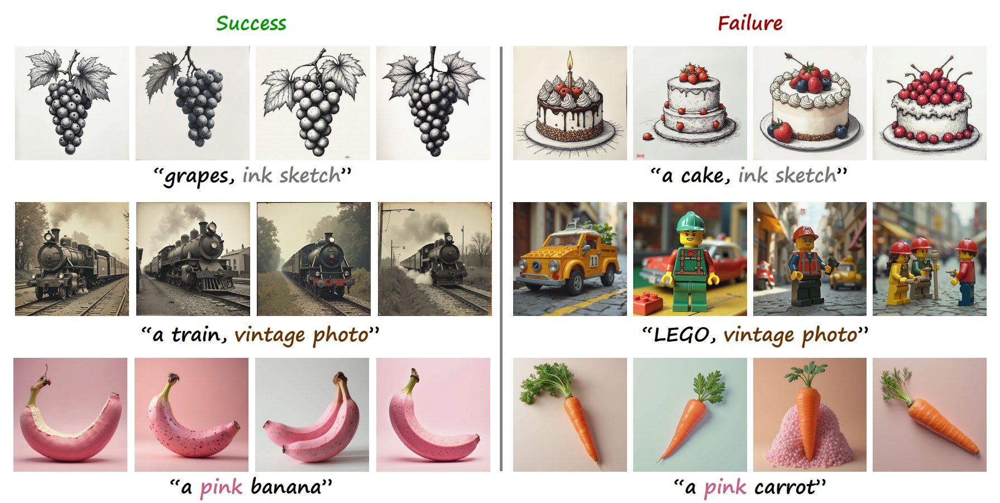
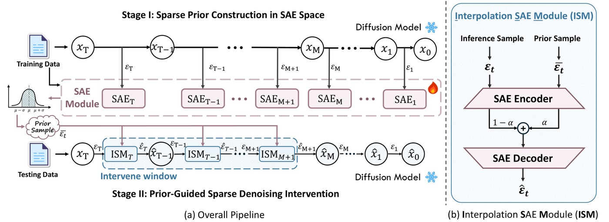
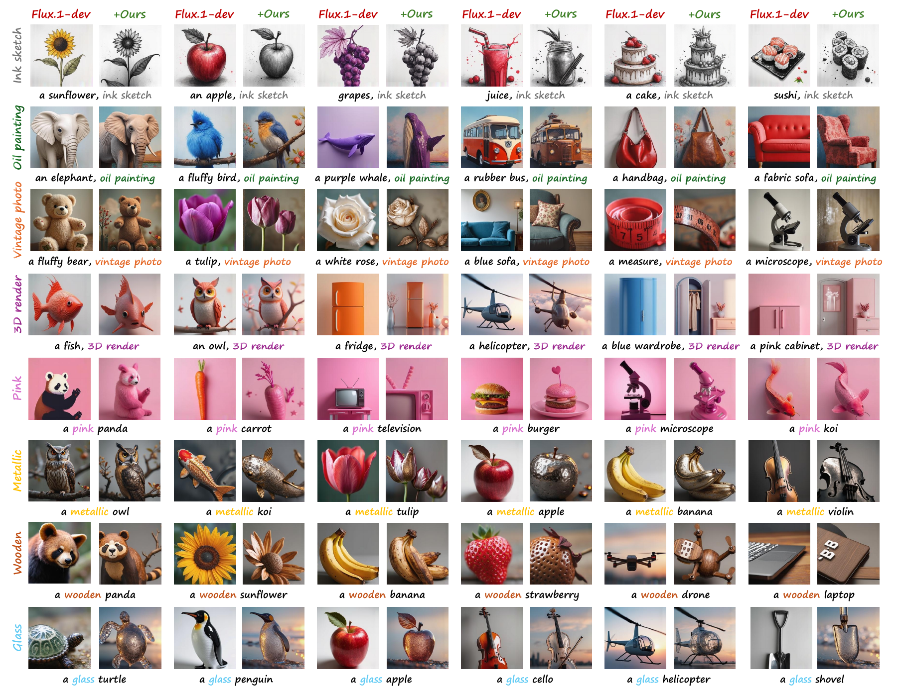
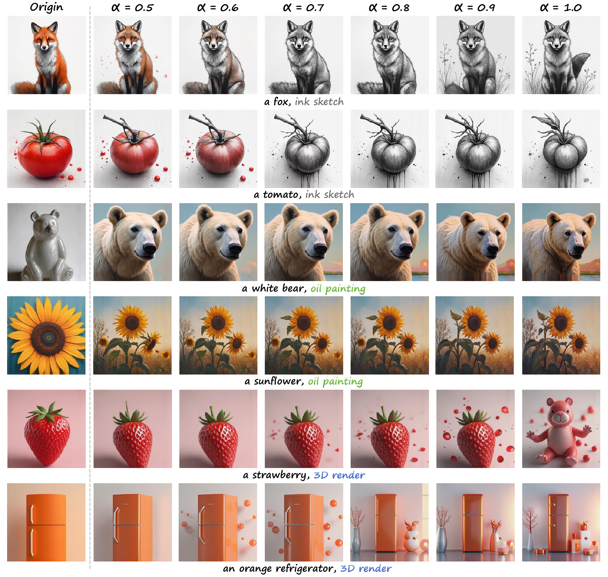
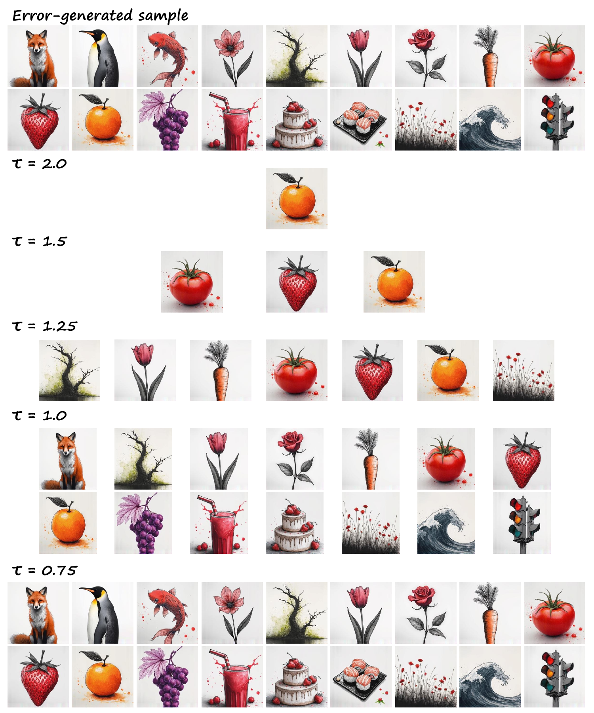
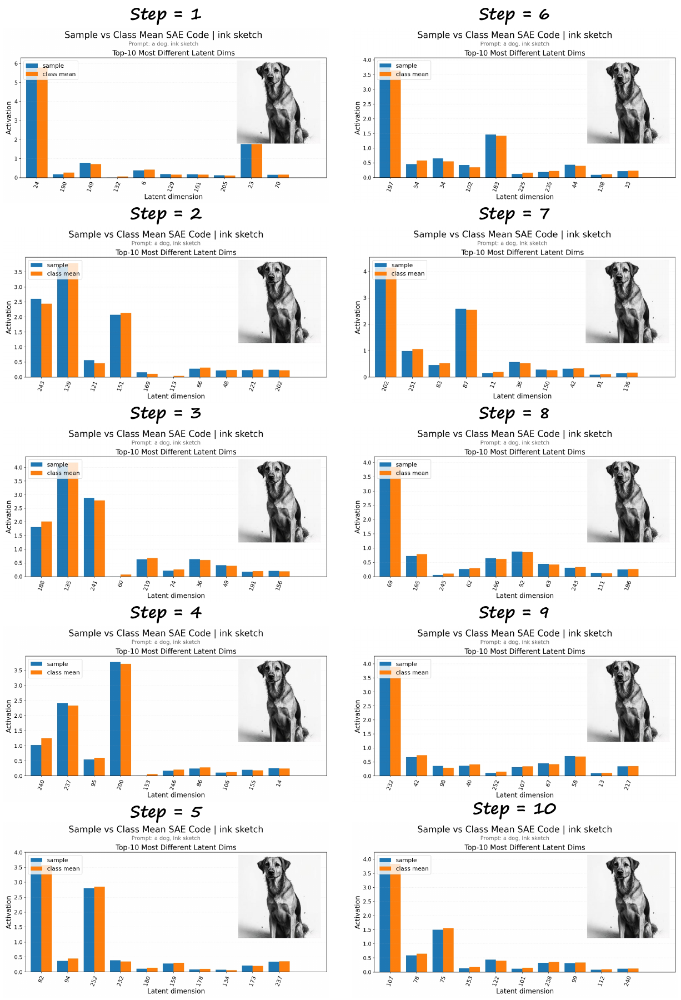
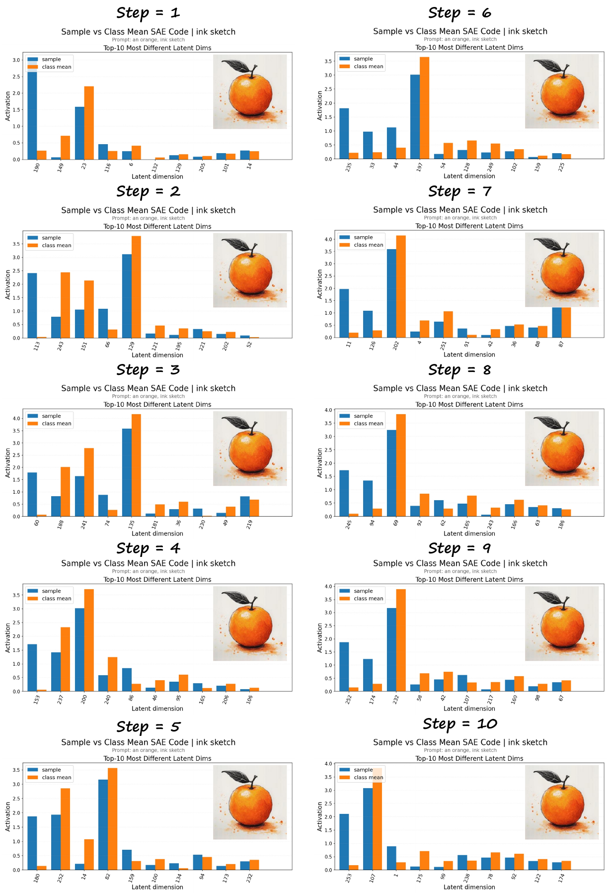

<div align="center">

# Interpreting Object-Dependent Concept Brittleness in Text-to-Image Diffusion Models

**Yifan Yuan**<sup>1*</sup> · **Xiangyu Liu**<sup>2*</sup> · **Hongming Shan**<sup>3</sup> · **Yu Han**<sup>4</sup> · **Yu Jiang**<sup>5</sup> · **Hao Tan**<sup>1</sup> · **Junping Zhang**<sup>6</sup> · **Linlin Shen**<sup>1&dagger;</sup>

<sup>1</sup>School of Artificial Intelligence, Shenzhen University &emsp; <sup>2</sup>School of Mathematical Sciences, Shenzhen University
<br>
<sup>3</sup>Institute of Science and Technology for Brain-inspired Intelligence, Fudan University &emsp; <sup>4</sup>College of Computer Science and Software Engineering, Shenzhen University
<br>
<sup>5</sup>Department of Statistics and Data Science, National University of Singapore &emsp; <sup>6</sup>College of Computer Science and Artificial Intelligence, Fudan University
<br>
<sup>*</sup>Equal contribution &emsp; <sup>&dagger;</sup>Corresponding author

**ACM MM 2026**

<a href="https://arxiv.org/abs/2609.09909"></a>
<a href="https://doi.org/10.1145/3767308.3835084"></a>
<a href="https://pytorch.org"></a>

</div>

<p align="center"><br><em>Object-dependent concept brittleness: for a fixed concept, FLUX.1-dev succeeds on most objects but repeatedly fails on a few (four random seeds each).</em></p>

**TL;DR:** Text-to-image diffusion models follow most prompts, yet a fixed concept such as *ink sketch* can fail again and again on a few objects — grapes become an ink sketch, a cake stays in full colour, whatever the seed. We call this **object-dependent concept brittleness** and show that it reflects systematic blind spots rather than sampling noise. Training a **sparse autoencoder (SAE) at every denoising step** makes abstract style and attribute concepts separable, so successful and failed generations can be compared, the missing, weakened or delayed concept dimensions located, and the failures **repaired at inference time** by nudging features toward a class-level concept prototype — no retraining.

## 🔍 Method

<p align="center"></p>

- **Stage I — sparse prior construction in SAE space.** Classifier-free-guided step updates $\varepsilon_t$ are collected on training prompts, and one Top-$K$ SAE is trained per denoising step. Reliable, class-consistent reference samples are selected in SAE space (outliers filtered with threshold $\tau$) and averaged into a concept prototype $\bar{\varepsilon}_t$ per class.
- **Stage II — prior-guided sparse denoising intervention.** In an early window of the denoising trajectory, the Interpolation SAE Module (ISM) encodes the current update and the prototype, interpolates them with coefficient $\alpha$ in sparse space and decodes the result back. The correction acts as a validation of the diagnosed concept deficiency rather than as task-specific retraining.

Default settings in the paper: $d_{model}=64$, latent width 256 (4× expansion), Top-$K$ sparsity $k=10$, $\alpha=0.8$ applied to the earliest 20% of the denoising steps.

## 🛠️ Installation

```bash
git clone https://github.com/MUSE-AI-Lab/Concept-Brittleness.git
cd Concept-Brittleness
conda create -n brittleness python=3.10 -y && conda activate brittleness
pip install -r requirements.txt      # PyTorch with CUDA is recommended; experiments used one A800 80GB GPU
```

## 📦 Model Weights

Weights are not distributed with the code. Put trusted local copies under `models/` (layout in [`models/README.md`](models/README.md)) or pass explicit paths (`python generate.py --help`).

| `--model` | Backbone | Weights |
|:-|:-|:-|
| `flux` | FLUX.1-dev | [black-forest-labs/FLUX.1-dev](https://huggingface.co/black-forest-labs/FLUX.1-dev) |
| `sd3.5` | Stable Diffusion 3.5 Large | [stabilityai/stable-diffusion-3.5-large](https://huggingface.co/stabilityai/stable-diffusion-3.5-large) |
| `sdxl` | Stable Diffusion XL | [stabilityai/stable-diffusion-xl-base-1.0](https://huggingface.co/stabilityai/stable-diffusion-xl-base-1.0) |
| `pixart` | PixArt-α (XL-2, 256px) | [PixArt-alpha/PixArt-alpha](https://huggingface.co/PixArt-alpha/PixArt-alpha) |
| `sd1.5` | Stable Diffusion 1.5 | [stable-diffusion-v1-5/stable-diffusion-v1-5](https://huggingface.co/stable-diffusion-v1-5/stable-diffusion-v1-5) |

## 🚀 Usage

The full pipeline (SDXL shown; replace `--model` for other backbones):

```bash
# 1. extract classifier-free-guided denoising step updates on the training prompts
python generate.py --model sdxl --mode save_feature

# 2. train one SAE per denoising timestep
python train_sae.py --data feature/step_updates_style_2026.pt \
    --d_model 16 --n_dirs 64 --checkpoint_dir checkpoints/sdxl

# 3. select reliable reference samples in SAE space
python select_reference_samples.py --data feature/step_updates_style_2026.pt \
    --checkpoint_dir checkpoints/sdxl --steps 0 1 2 \
    --remove_far --filtered_output feature/step_updates_style_filtered.pt

# 4. build class-level concept prototypes
python build_concept_prototypes.py --checkpoint_dir checkpoints/sdxl \
    --output_path feature/sdxl_style_prototypes.pt

# 5. prototype-guided correction in the early denoising window
python generate.py --model sdxl --mode sae_style_guide --ablation_steps 1,2,3,4,5,6,7,8,9,10
```

`generate.py` also supports `--mode normal` (plain sampling) and `--mode mean_ablation`; `--sae_alpha` sets the intervention strength $\alpha$ and `--prompt` / `--prompt_file` the prompts.

## 📊 Results

Held-out prompts, 256×256, official sampler settings of each backbone, seed 2026 (Table 1 of the paper):

| Model | CLIP-I ↑ | CLIP-T ↑ | Style Align. ↑ | Color ↑ | Texture ↑ | Shape ↑ | CLIPSim ↑ | Time (s) |
|:-|:-:|:-:|:-:|:-:|:-:|:-:|:-:|:-:|
| SD 1.5 | 0.644 | 0.327 | 0.237 | 0.204 | 0.195 | 0.236 | 0.217 | 1.23 |
| **SD 1.5 + Ours** | **0.659** | **0.333** | **0.239** | **0.336** | **0.328** | **0.330** | **0.231** | 1.26 |
| SD 3.5 | 0.725 | 0.261 | 0.220 | 0.341 | 0.302 | 0.451 | 0.245 | 15.41 |
| **SD 3.5 + Ours** | **0.797** | **0.297** | **0.221** | **0.461** | **0.437** | **0.475** | **0.250** | 15.70 |
| SDXL | 0.630 | 0.341 | 0.238 | 0.353 | 0.276 | 0.300 | 0.235 | 6.39 |
| **SDXL + Ours** | **0.653** | **0.359** | **0.243** | **0.415** | **0.361** | **0.318** | **0.237** | 6.39 |
| PixArt-α | 0.627 | 0.336 | 0.232 | 0.349 | 0.356 | 0.315 | 0.222 | 0.59 |
| **PixArt-α + Ours** | **0.629** | **0.338** | **0.239** | **0.368** | **0.366** | **0.358** | **0.247** | 0.61 |
| FLUX.1-dev | 0.598 | 0.273 | 0.220 | 0.379 | 0.326 | 0.240 | 0.229 | 4.10 |
| **FLUX.1-dev + Ours** | **0.623** | **0.288** | **0.230** | **0.394** | **0.346** | **0.379** | **0.233** | 4.15 |

Style generation is measured with CLIP-I / CLIP-T / Style Alignment, attribute control with BLIP-VQA (Color, Texture, Shape) and CLIPSim; the correction adds almost no inference time.

<p align="center"><br><em>Prototype-guided correction on FLUX.1-dev failures (ink sketch, oil painting, vintage photo, colour, material, 3D rendering).</em></p>

<details>
<summary><b>More analyses (click to expand)</b></summary>

**Intervention strength $\alpha$.** Larger values strengthen the requested style but can change the layout; $\alpha \approx 0.8$ gives the best repair–preservation balance.

<p align="center"></p>

**Reference filtering $\tau$.** A lower threshold rejects more failed references and gives purer class prototypes, at the cost of fewer and less diverse samples.

<p align="center"></p>

**Step-wise SAE diagnosis.** The successful *dog, ink sketch* sample (left) stays close to the class-mean sparse code during the first ten steps, while the failed *orange, ink sketch* sample (right) shows dominant-dimension mismatches from the earliest steps.

<p align="center">
  
  
</p>
</details>

## 📁 Repository Structure

```text
generate.py                    # sampling, feature extraction and prototype-guided correction (all backbones)
train_sae.py                   # one Top-K SAE per denoising step
select_reference_samples.py    # reliable reference selection in SAE space
build_concept_prototypes.py    # class-level concept prototypes
sae/                           # SAE model, dataset and config
src/                           # inference code of each backbone: flux1 · sd3_5 · sdxl · pixart · sd1_5
models/                        # local model weights (not included)
assets/                        # figures
```

The backbone implementations in `src/` are adapted from the official FLUX.1, Stable Diffusion 3.5 and PixArt-α code bases and remain subject to their original licenses.

## 📝 Citation

```bibtex
@inproceedings{yuan2026concept,
  title     = {Interpreting Object-Dependent Concept Brittleness in Text-to-Image Diffusion Models},
  author    = {Yuan, Yifan and Liu, Xiangyu and Shan, Hongming and Han, Yu and Jiang, Yu and Tan, Hao and Zhang, Junping and Shen, Linlin},
  booktitle = {Proceedings of the 34th ACM International Conference on Multimedia (MM '26)},
  year      = {2026},
  doi       = {10.1145/3767308.3835084}
}
```
