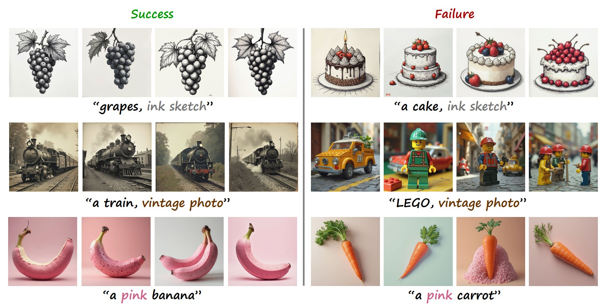
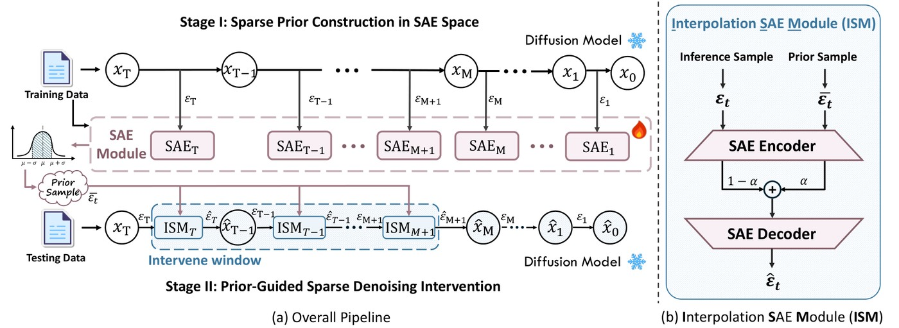
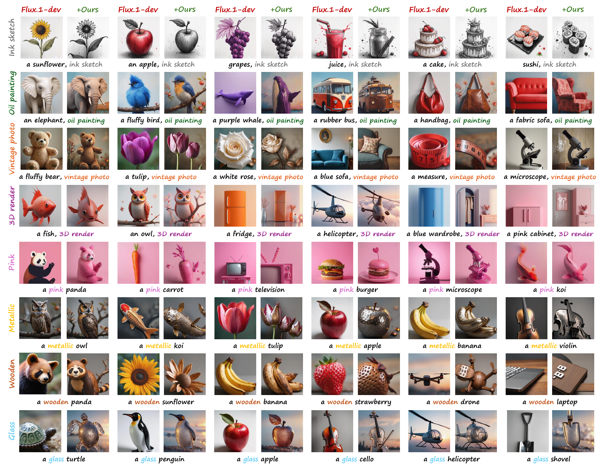
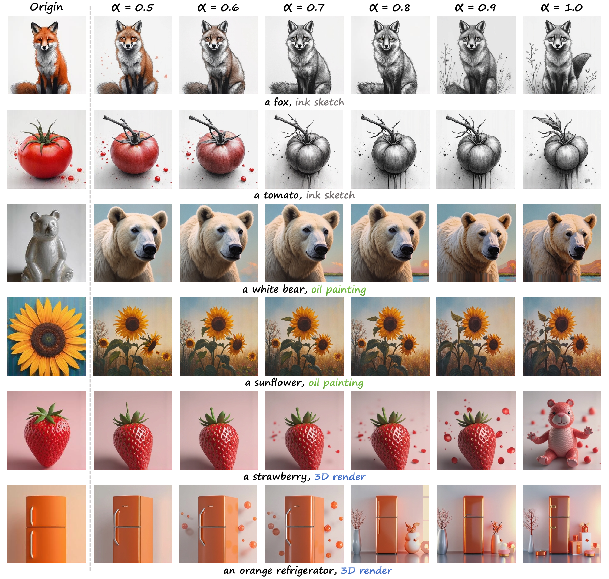
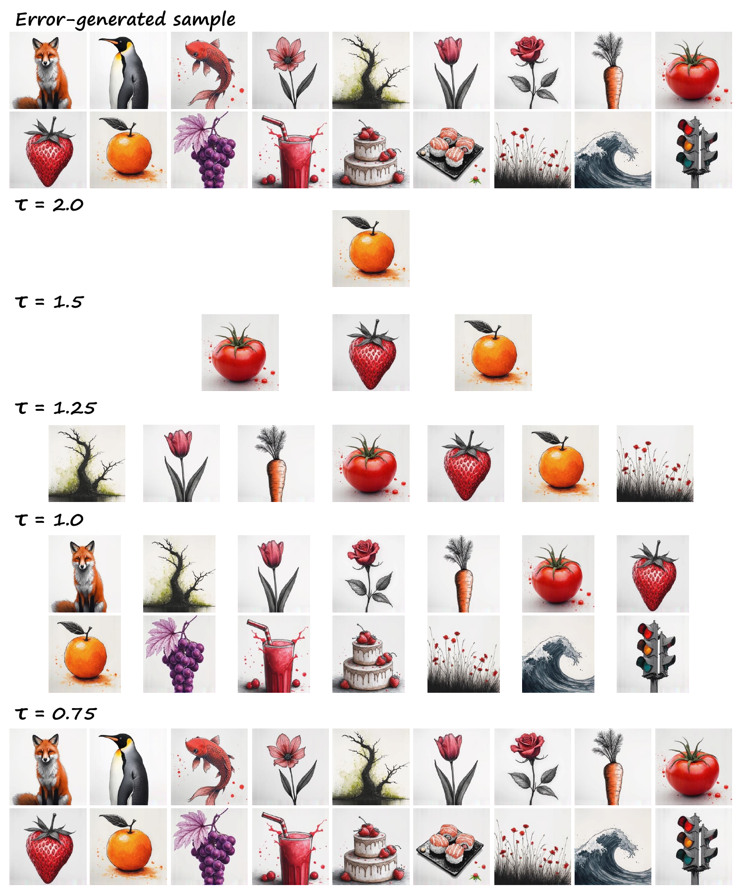
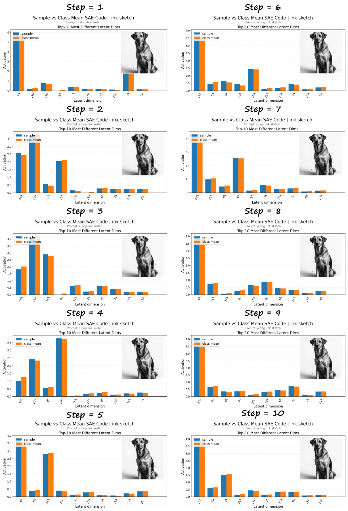
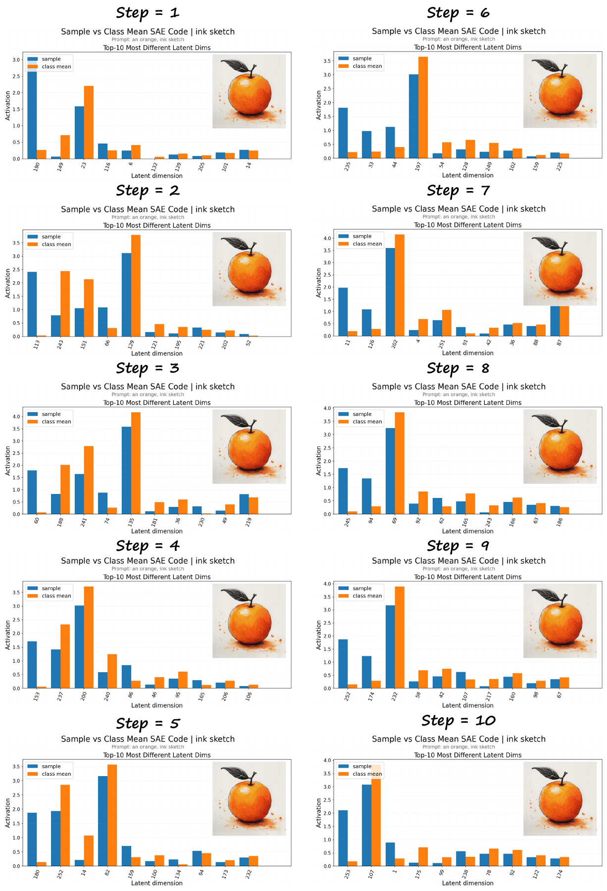

<div align="center">

# Interpreting Object-Dependent Concept Brittleness in Text-to-Image Diffusion Models

**Yifan Yuan**<sup>1*</sup> · **Xiangyu Liu**<sup>2*</sup> · **Hongming Shan**<sup>3</sup> · **Yu Han**<sup>4</sup> · **Yu Jiang**<sup>5</sup> · **Hao Tan**<sup>1</sup> · **Junping Zhang**<sup>6</sup> · **Linlin Shen**<sup>1&dagger;</sup>

<sup>1</sup>School of Artificial Intelligence, Shenzhen University &emsp; <sup>2</sup>School of Mathematical Sciences, Shenzhen University
<br>
<sup>3</sup>Institute of Science and Technology for Brain-inspired Intelligence, Fudan University &emsp; <sup>4</sup>College of Computer Science and Software Engineering, Shenzhen University
<br>
<sup>5</sup>Department of Statistics and Data Science, National University of Singapore &emsp; <sup>6</sup>College of Computer Science and Artificial Intelligence, Fudan University
<br>
<sup>*</sup>同等贡献 &emsp; <sup>&dagger;</sup>通讯作者

**ACM MM 2026**

<a href="https://arxiv.org/abs/2609.09909"></a>
<a href="https://doi.org/10.1145/3767308.3835084"></a>
<a href="https://pytorch.org"></a>

[English](README.md) · [简体中文](README_zh.md)

</div>

<p align="center"><br><em>物体依赖的概念脆弱性：对于同一个概念，FLUX.1-dev 在大多数物体上都能成功生成，却在少数物体上反复失败（每个物体使用四个随机种子）。</em></p>

**一句话总结：** 文生图扩散模型能够遵循大多数提示词，但同一个概念（如 *ink sketch*）却可能在少数物体上屡屡失败：无论随机种子如何，葡萄都能画成水墨素描，蛋糕却始终保持全彩。我们将这一现象称为**物体依赖的概念脆弱性**（object-dependent concept brittleness），并表明它反映的是系统性盲区，而非采样噪声。通过**在每个去噪步上分别训练稀疏自编码器（SAE）**，抽象的风格与属性概念变得可分离。这样就能对比成功与失败的生成结果，定位缺失、减弱或延迟出现的概念维度，并在**推理阶段修复**这些失败：只需将特征朝类别级概念原型的方向轻推，无需重新训练。

## 🔍 方法

<p align="center"></p>

- **阶段 I：在 SAE 空间中构建稀疏先验。** 在训练提示词上收集经无分类器引导的单步更新量 $\varepsilon_t$，并为每个去噪步训练一个 Top-$K$ SAE。随后在 SAE 空间中筛选可靠且类别一致的参考样本（以阈值 $\tau$ 过滤离群样本），并按类别取平均，得到概念原型 $\bar{\varepsilon}_t$。
- **阶段 II：先验引导的稀疏去噪干预。** 在去噪轨迹的早期窗口内，Interpolation SAE Module (ISM) 对当前更新量和概念原型进行编码，在稀疏空间中以系数 $\alpha$ 对二者插值，再将结果解码回去。这一校正的作用是验证所诊断出的概念缺陷，而非针对特定任务的重新训练。

论文中的默认设置：$d_{model}=64$，隐层宽度 256（4 倍扩展），Top-$K$ 稀疏度 $k=10$，并在最早 20% 的去噪步中施加 $\alpha=0.8$ 的干预。

## 🛠️ 安装

```bash
git clone https://github.com/MUSE-AI-Lab/Concept-Brittleness.git
cd Concept-Brittleness
conda create -n brittleness python=3.10 -y && conda activate brittleness
pip install -r requirements.txt      # 建议使用带 CUDA 的 PyTorch；论文实验使用一张 A800 80GB GPU
```

## 📦 模型权重

模型权重不随代码分发。请将可信的本地副本放在 `models/` 下（目录结构见 [`models/README.md`](models/README.md)），或显式传入路径（参见 `python generate.py --help`）。

| `--model` | 骨干模型 | 权重 |
|:-|:-|:-|
| `flux` | FLUX.1-dev | [black-forest-labs/FLUX.1-dev](https://huggingface.co/black-forest-labs/FLUX.1-dev) |
| `sd3.5` | Stable Diffusion 3.5 Large | [stabilityai/stable-diffusion-3.5-large](https://huggingface.co/stabilityai/stable-diffusion-3.5-large) |
| `sdxl` | Stable Diffusion XL | [stabilityai/stable-diffusion-xl-base-1.0](https://huggingface.co/stabilityai/stable-diffusion-xl-base-1.0) |
| `pixart` | PixArt-α (XL-2, 256px) | [PixArt-alpha/PixArt-alpha](https://huggingface.co/PixArt-alpha/PixArt-alpha) |
| `sd1.5` | Stable Diffusion 1.5 | [stable-diffusion-v1-5/stable-diffusion-v1-5](https://huggingface.co/stable-diffusion-v1-5/stable-diffusion-v1-5) |

## 🚀 使用方法

完整流水线如下（以 SDXL 为例；用于其他骨干模型时替换 `--model` 即可）：

```bash
# 1. 在训练提示词上提取经无分类器引导的去噪单步更新量
python generate.py --model sdxl --mode save_feature

# 2. 为每个去噪步训练一个 SAE
python train_sae.py --data feature/step_updates_style_2026.pt \
    --d_model 16 --n_dirs 64 --checkpoint_dir checkpoints/sdxl

# 3. 在 SAE 空间中筛选可靠的参考样本
python select_reference_samples.py --data feature/step_updates_style_2026.pt \
    --checkpoint_dir checkpoints/sdxl --steps 0 1 2 \
    --remove_far --filtered_output feature/step_updates_style_filtered.pt

# 4. 构建类别级概念原型
python build_concept_prototypes.py --checkpoint_dir checkpoints/sdxl \
    --output_path feature/sdxl_style_prototypes.pt

# 5. 在去噪早期窗口内进行原型引导校正
python generate.py --model sdxl --mode sae_style_guide --ablation_steps 1,2,3,4,5,6,7,8,9,10
```

`generate.py` 还支持 `--mode normal`（普通采样）和 `--mode mean_ablation`；`--sae_alpha` 用于设置干预强度 $\alpha$，`--prompt` / `--prompt_file` 用于指定提示词。

## 📊 实验结果

测试使用留出提示词，分辨率为 256×256，各骨干模型采用官方采样器设置，随机种子为 2026（论文表 1）：

| 模型 | CLIP-I ↑ | CLIP-T ↑ | Style Align. ↑ | Color ↑ | Texture ↑ | Shape ↑ | CLIPSim ↑ | 耗时（秒） |
|:-|:-:|:-:|:-:|:-:|:-:|:-:|:-:|:-:|
| SD 1.5 | 0.644 | 0.327 | 0.237 | 0.204 | 0.195 | 0.236 | 0.217 | 1.23 |
| **SD 1.5 + 本文方法** | **0.659** | **0.333** | **0.239** | **0.336** | **0.328** | **0.330** | **0.231** | 1.26 |
| SD 3.5 | 0.725 | 0.261 | 0.220 | 0.341 | 0.302 | 0.451 | 0.245 | 15.41 |
| **SD 3.5 + 本文方法** | **0.797** | **0.297** | **0.221** | **0.461** | **0.437** | **0.475** | **0.250** | 15.70 |
| SDXL | 0.630 | 0.341 | 0.238 | 0.353 | 0.276 | 0.300 | 0.235 | 6.39 |
| **SDXL + 本文方法** | **0.653** | **0.359** | **0.243** | **0.415** | **0.361** | **0.318** | **0.237** | 6.39 |
| PixArt-α | 0.627 | 0.336 | 0.232 | 0.349 | 0.356 | 0.315 | 0.222 | 0.59 |
| **PixArt-α + 本文方法** | **0.629** | **0.338** | **0.239** | **0.368** | **0.366** | **0.358** | **0.247** | 0.61 |
| FLUX.1-dev | 0.598 | 0.273 | 0.220 | 0.379 | 0.326 | 0.240 | 0.229 | 4.10 |
| **FLUX.1-dev + 本文方法** | **0.623** | **0.288** | **0.230** | **0.394** | **0.346** | **0.379** | **0.233** | 4.15 |

风格生成以 CLIP-I / CLIP-T / Style Alignment 评估，属性控制以 BLIP-VQA（Color、Texture、Shape）和 CLIPSim 评估；校正几乎不增加推理时间。

<p align="center"><br><em>对 FLUX.1-dev 失败样例的原型引导校正（水墨素描、油画、复古照片、颜色、材质、3D 渲染）。</em></p>

<details>
<summary><b>更多分析（点击展开）</b></summary>

**干预强度 $\alpha$。** 取值越大，目标风格越强，但可能改变画面布局；$\alpha \approx 0.8$ 时修复效果与内容保持之间的平衡最好。

<p align="center"></p>

**参考样本过滤阈值 $\tau$。** 阈值越低，剔除的失败参考样本越多，得到的类别原型越纯净，但代价是样本更少、多样性更低。

<p align="center"></p>

**逐去噪步 SAE 诊断。** 成功样本 *dog, ink sketch*（左）在前十步中始终接近类别均值稀疏编码，而失败样本 *orange, ink sketch*（右）从最初几步起就出现主导维度失配。

<p align="center">
  
  
</p>
</details>

## 📁 仓库结构

```text
generate.py                    # 采样、特征提取与原型引导校正（适用于所有骨干模型）
train_sae.py                   # 每个去噪步训练一个 Top-K SAE
select_reference_samples.py    # 在 SAE 空间中筛选可靠的参考样本
build_concept_prototypes.py    # 类别级概念原型
sae/                           # SAE 模型、数据集与配置
src/                           # 各骨干模型的推理代码：flux1 · sd3_5 · sdxl · pixart · sd1_5
models/                        # 本地模型权重（不随仓库提供）
assets/                        # 图片
```

`src/` 中的骨干模型实现改编自 FLUX.1、Stable Diffusion 3.5 和 PixArt-α 的官方代码库，仍受其原始许可约束。

## 📝 引用

```bibtex
@inproceedings{yuan2026concept,
  title     = {Interpreting Object-Dependent Concept Brittleness in Text-to-Image Diffusion Models},
  author    = {Yuan, Yifan and Liu, Xiangyu and Shan, Hongming and Han, Yu and Jiang, Yu and Tan, Hao and Zhang, Junping and Shen, Linlin},
  booktitle = {Proceedings of the 34th ACM International Conference on Multimedia (MM '26)},
  year      = {2026},
  doi       = {10.1145/3767308.3835084}
}
```
